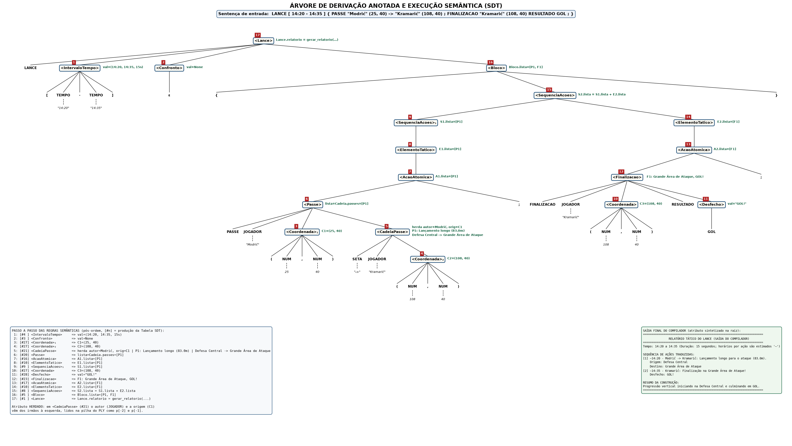
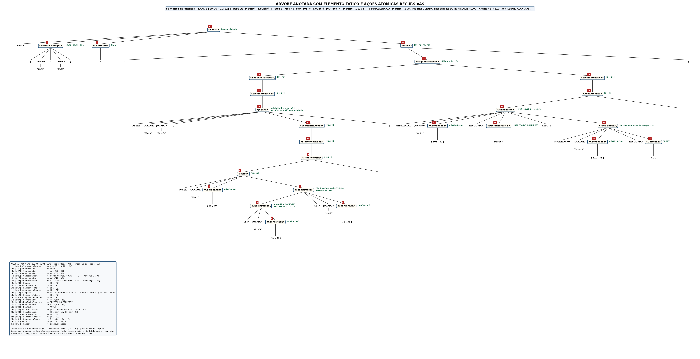

# Árvores de Derivação (Sintática e Anotada)

**Disciplina:** Compiladores (2026_2)  
**Projeto:** Tradutor Tático de Futebol Dirigido pela Sintaxe (StatsBomb 120x80)  
**Numeração das produções:** a mesma de `01_GRAMATICA_BNF.md` e `02_TABELA_SDT.md` (31 produções).  
**Figuras:** geradas por `python docs/gerar_arvores.py`, que usa as próprias funções do compilador para calcular as anotações.

---

## Exemplo 1: lance simples (`exemplos/lance_croacia.txt`)

```text
LANCE [14:20 - 14:35] {
    PASSE "Luka Modrić" (25.4, 40.2) -> "Mateo Kovačić" (38.2, 42.1);
    PASSE "Mateo Kovačić" (38.2, 42.1) -> "Andrej Kramarić" (85.0, 18.5);
    FINALIZACAO "Andrej Kramarić" (108.5, 39.8) RESULTADO GOL;
}
```

### 1.1 Árvore de derivação sintática (parse tree pura)

As subárvores de `<Coordenada>` (#27) estão indicadas como `<Coordenada> → ( NUM , NUM )` para economizar espaço. Desenhadas por completo, cada uma tem os 5 filhos `'(' NUM ',' NUM ')'`.

```text
<Lance>                                                        #1
 ├── LANCE
 ├── <IntervaloTempo>                                          #4
 │    ├── '['   ├── TEMPO ("14:20")   ├── '-'   ├── TEMPO ("14:35")   └── ']'
 ├── <Confronto>                                               #3
 │    └── ε
 └── <Bloco>                                                   #5
      ├── '{'
      ├── <SequenciaAcoes>                                     #8
      │    ├── <SequenciaAcoes>                                #8
      │    │    ├── <SequenciaAcoes>                           #9
      │    │    │    └── <ElementoTatico>                      #10
      │    │    │         └── <AcaoAtomica>                    #16
      │    │    │              ├── <Passe>                     #20
      │    │    │              │    ├── PASSE
      │    │    │              │    ├── JOGADOR ("Luka Modrić")
      │    │    │              │    ├── <Coordenada> → ( 25.4 , 40.2 )        #27
      │    │    │              │    └── <CadeiaPasse>          #21
      │    │    │              │         ├── SETA ("->")
      │    │    │              │         ├── JOGADOR ("Mateo Kovačić")
      │    │    │              │         └── <Coordenada> → ( 38.2 , 42.1 )   #27
      │    │    │              └── ';'
      │    │    └── <ElementoTatico>                           #10
      │    │         └── <AcaoAtomica>                         #16
      │    │              ├── <Passe>                          #20
      │    │              │    ├── PASSE
      │    │              │    ├── JOGADOR ("Mateo Kovačić")
      │    │              │    ├── <Coordenada> → ( 38.2 , 42.1 )             #27
      │    │              │    └── <CadeiaPasse>               #21
      │    │              │         ├── SETA ("->")
      │    │              │         ├── JOGADOR ("Andrej Kramarić")
      │    │              │         └── <Coordenada> → ( 85.0 , 18.5 )        #27
      │    │              └── ';'
      │    └── <ElementoTatico>                                #10
      │         └── <AcaoAtomica>                              #17
      │              ├── <Finalizacao>                         #23
      │              │    ├── FINALIZACAO
      │              │    ├── JOGADOR ("Andrej Kramarić")
      │              │    ├── <Coordenada> → ( 108.5 , 39.8 )                 #27
      │              │    ├── RESULTADO
      │              │    └── <Desfecho>                       #28
      │              │         └── GOL
      │              └── ';'
      └── '}'
```

### 1.2 Árvore de derivação anotada

Atributos sintetizados (↑) calculados de baixo para cima durante as reduções do `ply.yacc`. O atributo **herdado** (↓) aparece em `<CadeiaPasse>` (#21): o autor e a origem do passe vêm dos irmãos à esquerda (`p[-2]`, `p[-1]` na pilha do PLY).

```text
<Lance>.relatorio ↑ = gerar_relatorio(IntervaloTempo.val, None, [P1, P2, F1])
 ├── LANCE
 ├── <IntervaloTempo>.val ↑ = {inicio: "14:20", fim: "14:35", duracao: 15 s}
 ├── <Confronto>.val ↑ = None            (equipes inferidas; aqui não há POSSE)
 └── <Bloco>.lista ↑ = [P1, P2, F1]
      ├── '{'
      ├── <SequenciaAcoes>.lista ↑ = S₂.lista + E₃.lista = [P1, P2, F1]
      │    ├── <SequenciaAcoes>₂.lista ↑ = S₁.lista + E₂.lista = [P1, P2]
      │    │    ├── <SequenciaAcoes>₁.lista ↑ = [P1]
      │    │    │    └── <ElementoTatico>₁.lista ↑ = [P1]
      │    │    │         └── <AcaoAtomica>₁.lista ↑ = [P1]
      │    │    │              ├── <Passe>.lista ↑ = CadeiaPasse.passes = [P1]
      │    │    │              │    ├── PASSE
      │    │    │              │    ├── JOGADOR.lexval = "Luka Modrić"   ──┐ herdado
      │    │    │              │    ├── <Coordenada>.val = (25.4, 40.2)   ──┤ herdado
      │    │    │              │    └── <CadeiaPasse> ↓ autor = "Luka Modrić", orig = (25.4, 40.2)
      │    │    │              │         .passes ↑ = [P1]
      │    │    │              │         P1 = { autor: Modrić, receptor: Kovačić,
      │    │    │              │                ΔX = +12.8, ΔY = +1.9, d = 12.9 m,
      │    │    │              │                zona_orig: "Defesa Central", zona_dest: "Defesa Central",
      │    │    │              │                tipo: "Passe curto", dir: "para frente" }
      │    │    │              │         ├── SETA
      │    │    │              │         ├── JOGADOR.lexval = "Mateo Kovačić"
      │    │    │              │         └── <Coordenada>.val = (38.2, 42.1)
      │    │    │              └── ';'
      │    │    └── <ElementoTatico>₂.lista ↑ = [P2]
      │    │         └── <AcaoAtomica>₂.lista ↑ = [P2]
      │    │              ├── <Passe>.lista ↑ = [P2]
      │    │              │    ├── PASSE
      │    │              │    ├── JOGADOR.lexval = "Mateo Kovačić"
      │    │              │    ├── <Coordenada>.val = (38.2, 42.1)
      │    │              │    └── <CadeiaPasse> ↓ autor = "Mateo Kovačić", orig = (38.2, 42.1)
      │    │              │         P2 = { ΔX = +46.8, ΔY = −23.6, d = 52.4 m,
      │    │              │                zona_orig: "Defesa Central", zona_dest: "Ataque Esquerdo",
      │    │              │                tipo: "Lançamento longo", dir: "para o ataque" }
      │    │              │         ├── SETA
      │    │              │         ├── JOGADOR.lexval = "Andrej Kramarić"
      │    │              │         └── <Coordenada>.val = (85.0, 18.5)
      │    │              └── ';'
      │    └── <ElementoTatico>₃.lista ↑ = [F1]
      │         └── <AcaoAtomica>₃.lista ↑ = [F1]
      │              ├── <Finalizacao>.lista ↑ = [F1]
      │              │    F1 = { autor: Kramarić, zona: "Grande Área de Ataque",
      │              │           desfecho: "GOL!", tentativa: 1 }
      │              │    ├── FINALIZACAO
      │              │    ├── JOGADOR.lexval = "Andrej Kramarić"
      │              │    ├── <Coordenada>.val = (108.5, 39.8)
      │              │    ├── RESULTADO
      │              │    └── <Desfecho>.val ↑ = "GOL!"
      │              │         └── GOL
      │              └── ';'
      └── '}'
```

> **Por que (38.2, 42.1) é "Defesa Central":** o limiar do meio-campo foi unificado em X ≥ 40 (três terços iguais de 40 m). Antes o compilador usava 38 e o extrator usava 40.

---

## Exemplo 2: estilo do quadro da professora (pós-ordem numerada)

Sentença: `LANCE [14:20 - 14:35] { PASSE "Modrić" (25, 40) -> "Kramarić" (108, 40) ; FINALIZACAO "Kramarić" (108, 40) RESULTADO GOL ; }`



O passo a passo `1:` a `17:` está em `EXEMPLO_ARVORE_ESTILO_QUADRO_PROFESSORA.md`.

---

## Exemplo 3: recursividade (correção pedida pela professora)

Sentença:

```text
LANCE [10:00 - 10:12] {
  TABELA "Modrić" "Kovačić" {
    PASSE "Modrić" (50, 40) -> "Kovačić" (60, 46) -> "Modrić" (72, 38);
  }
  FINALIZACAO "Modrić" (105, 40) RESULTADO DEFESA REBOTE
    FINALIZACAO "Kramarić" (110, 36) RESULTADO GOL;
}
```



O que a árvore mostra:

| Nó | Produção | Recursão | Semântica |
| :--- | :--- | :--- | :--- |
| `<Jogada>` | #13 TABELA | auto-incorporação: contém `<SequenciaAcoes>`, que pode conter outra `<Jogada>` ou `<Bloco>` | **valida** Modrić→Kovačić e Kovačić→Modrić; senão erro semântico |
| `<CadeiaPasse>` → `<CadeiaPasse>₁ SETA JOGADOR <Coordenada>` | #22 / #21 | à **esquerda** | o 2º passe sai de quem recebeu o 1º (`ultimo`, `ultima_coord`); o 1º herda autor/origem de `<Passe>` |
| `<Finalizacao>` → `… <DesfechoParcial> REBOTE <Finalizacao>₁` | #24 / #23 | à **direita** | lista = [chute 1] + rebotes, com `tentativa` 1, 2, … |

Ordem de redução (pós-ordem) dos nós recursivos: `<CadeiaPasse>₁` (5) → `<CadeiaPasse>` (7) → `<Passe>` (8) → … → `<Jogada>` (12). Do lado dos chutes: `<Finalizacao>₁` (19), o chute **mais interno**, é reduzido **antes** de `<Finalizacao>` (20). Esta é a marca da recursão à direita.
