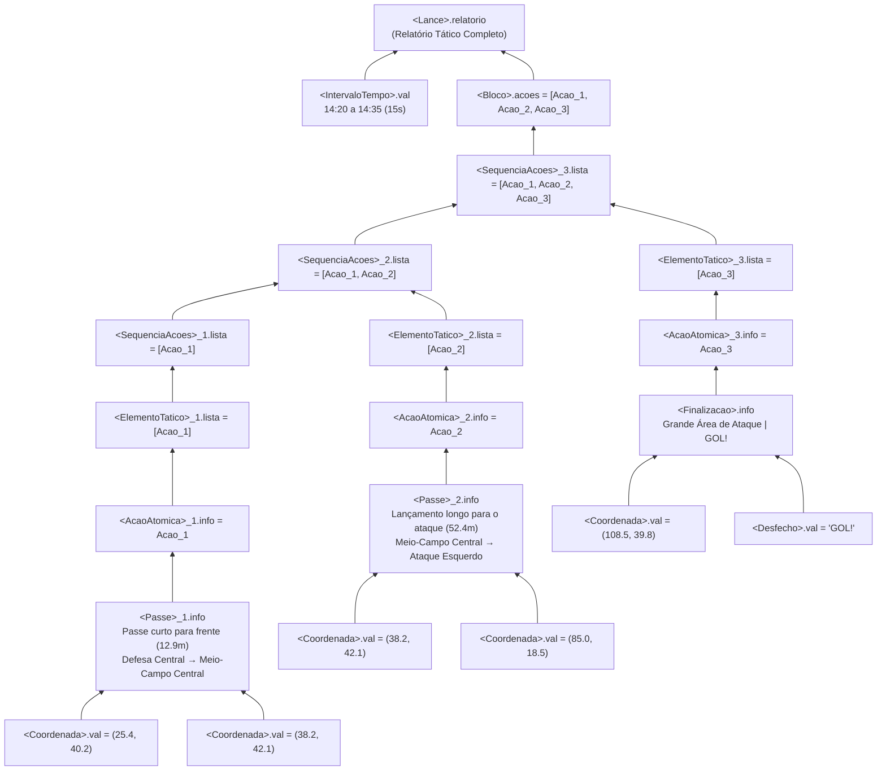

# Exemplos de Árvores de Derivação (Sintática e Anotada)

**Disciplina:** Compiladores (2026_2)  
**Projeto:** Tradutor Tático de Futebol Dirigido pela Sintaxe (StatsBomb 120x80)

---

## Sentença de Entrada Analisada

```text
LANCE [14:20 - 14:35] {
    PASSE "Luka Modrić" (25.4, 40.2) -> "Mateo Kovačić" (38.2, 42.1);
    PASSE "Mateo Kovačić" (38.2, 42.1) -> "Ivan Perišić" (85.0, 18.5);
    FINALIZACAO "Andrej Kramarić" (108.5, 39.8) RESULTADO GOL;
}
```

---

## 1. Árvore de Derivação Sintática (Parse Tree Pura)

Demonstra exclusivamente a estrutura hierárquica gerada pelas regras gramaticais BNF (com recursão à esquerda em `<SequenciaAcoes>`), sem anotações semânticas:

```text
<Lance>
 ├── LANCE
 ├── <IntervaloTempo>
 │    ├── '['
 │    ├── TEMPO ("14:20")
 │    ├── '-'
 │    ├── TEMPO ("14:35")
 │    └── ']'
 └── <Bloco>
      ├── '{'
      ├── <SequenciaAcoes>
      │    ├── <SequenciaAcoes>
      │    │    ├── <SequenciaAcoes>
      │    │    │    └── <ElementoTatico>
      │    │    │         └── <AcaoAtomica>
      │    │    │              ├── <Passe>
      │    │    │              │    ├── PASSE
      │    │    │              │    ├── JOGADOR ("Luka Modrić")
      │    │    │              │    ├── <Coordenada>
      │    │    │              │    │    ├── '('
      │    │    │              │    │    ├── NUM (25.4)
      │    │    │              │    │    ├── ','
      │    │    │              │    │    ├── NUM (40.2)
      │    │    │              │    │    └── ')'
      │    │    │              │    ├── '->'
      │    │    │              │    ├── JOGADOR ("Mateo Kovačić")
      │    │    │              │    └── <Coordenada>
      │    │    │              │         ├── '('
      │    │    │              │         ├── NUM (38.2)
      │    │    │              │         ├── ','
      │    │    │              │         ├── NUM (42.1)
      │    │    │              │         └── ')'
      │    │    │              └── ';'
      │    │    └── <ElementoTatico>
      │    │         └── <AcaoAtomica>
      │    │              ├── <Passe>
      │    │              │    ├── PASSE
      │    │              │    ├── JOGADOR ("Mateo Kovačić")
      │    │              │    ├── <Coordenada>
      │    │              │    │    ├── '('
      │    │              │    │    ├── NUM (38.2)
      │    │              │    │    ├── ','
      │    │              │    │    ├── NUM (42.1)
      │    │              │    │    └── ')'
      │    │              │    ├── '->'
      │    │              │    ├── JOGADOR ("Ivan Perišić")
      │    │              │    └── <Coordenada>
      │    │              │         ├── '('
      │    │              │         ├── NUM (85.0)
      │    │              │         ├── ','
      │    │              │         ├── NUM (18.5)
      │    │              │         └── ')'
      │    │              └── ';'
      │    └── <ElementoTatico>
      │         └── <AcaoAtomica>
      │              ├── <Finalizacao>
      │              │    ├── FINALIZACAO
      │              │    ├── JOGADOR ("Andrej Kramarić")
      │              │    ├── <Coordenada>
      │              │    │    ├── '('
      │              │    │    ├── NUM (108.5)
      │              │    │    ├── ','
      │              │    │    ├── NUM (39.8)
      │              │    │    └── ')'
      │              │    ├── RESULTADO
      │              │    └── <Desfecho>
      │              │         └── GOL
      │              └── ';'
      └── '}'
```

---

## 2. Árvore de Derivação Anotada (Annotated Parse Tree)

Exibe os atributos sintetizados ($\uparrow$) calculados de baixo para cima (*bottom-up*) durante as reduções do `ply.yacc`:

```text
<Lance>.relatorio = "Tempo: 14:20 a 14:35 (15s) | [1] Modrić (12.9m/13.0m)... | [2] Kovačić (52.4m)... | [3] Kramarić (GOL!)"
 ├── LANCE
 ├── <IntervaloTempo>.val = {inicio: "14:20", fim: "14:35", duracao_seg: 15}
 │    ├── '['
 │    ├── TEMPO.lexval = "14:20"
 │    ├── '-'
 │    ├── TEMPO.lexval = "14:35"
 │    └── ']'
 └── <Bloco>.acoes = [ Acao_1, Acao_2, Acao_3 ]
      ├── '{'
      ├── <SequenciaAcoes>.lista = [ Acao_1, Acao_2, Acao_3 ]
      │    ├── <SequenciaAcoes>_2.lista = [ Acao_1, Acao_2 ]
      │    │    ├── <SequenciaAcoes>_1.lista = [ Acao_1 ]
      │    │    │    └── <ElementoTatico>_1.lista = [ Acao_1 ]
      │    │    │         └── <AcaoAtomica>_1.info = Acao_1
      │    │    │              ├── <Passe>_1.info = Acao_1 {
      │    │    │              │     tipo_acao: "PASSE",
      │    │    │              │     autor: "Luka Modrić", receptor: "Mateo Kovačić",
      │    │    │              │     distancia: 12.9m, dx: +12.8, dy: +1.9,
      │    │    │              │     zona_orig: "Defesa Central",
      │    │    │              │     zona_dest: "Meio-Campo Central",
      │    │    │              │     classificacao: "Passe curto", direcao: "para frente"
      │    │    │              │   }
      │    │    │              │    ├── PASSE
      │    │    │              │    ├── JOGADOR_1.lexval = "Luka Modrić"
      │    │    │              │    ├── <Coordenada>_1.val = (25.4, 40.2)
      │    │    │              │    │    └── [NUM(25.4), NUM(40.2)]
      │    │    │              │    ├── '->'
      │    │    │              │    ├── JOGADOR_2.lexval = "Mateo Kovačić"
      │    │    │              │    └── <Coordenada>_2.val = (38.2, 42.1)
      │    │    │              │         └── [NUM(38.2), NUM(42.1)]
      │    │    │              └── ';'
      │    │    └── <ElementoTatico>_2.lista = [ Acao_2 ]
      │    │         └── <AcaoAtomica>_2.info = Acao_2
      │    │              ├── <Passe>_2.info = Acao_2 {
      │    │              │     tipo_acao: "PASSE",
      │    │              │     autor: "Mateo Kovačić", receptor: "Ivan Perišić",
      │    │              │     distancia: 52.4m, dx: +46.8, dy: -23.6,
      │    │              │     zona_orig: "Meio-Campo Central",
      │    │              │     zona_dest: "Ataque Esquerdo",
      │    │              │     classificacao: "Lançamento longo", direcao: "para o ataque"
      │    │              │   }
      │    │              │    ├── PASSE
      │    │              │    ├── JOGADOR_1.lexval = "Mateo Kovačić"
      │    │              │    ├── <Coordenada>_1.val = (38.2, 42.1)
      │    │              │    ├── '->'
      │    │              │    ├── JOGADOR_2.lexval = "Ivan Perišić"
      │    │              │    └── <Coordenada>_2.val = (85.0, 18.5)
      │    │              └── ';'
      │    └── <ElementoTatico>_3.lista = [ Acao_3 ]
      │         └── <AcaoAtomica>_3.info = Acao_3
      │              ├── <Finalizacao>.info = Acao_3 {
      │              │     tipo_acao: "FINALIZACAO",
      │              │     autor: "Andrej Kramarić",
      │              │     coord_orig: (108.5, 39.8),
      │              │     zona_orig: "Grande Área de Ataque",
      │              │     desfecho: "GOL!"
      │              │   }
      │              │    ├── FINALIZACAO
      │              │    ├── JOGADOR.lexval = "Andrej Kramarić"
      │              │    ├── <Coordenada>.val = (108.5, 39.8)
      │              │    ├── RESULTADO
      │              │    └── <Desfecho>.val = "GOL!"
      │              │         └── GOL
      │              └── ';'
      └── '}'
```

---

## 3. Diagrama Visual da Árvore Anotada (Mermaid)


