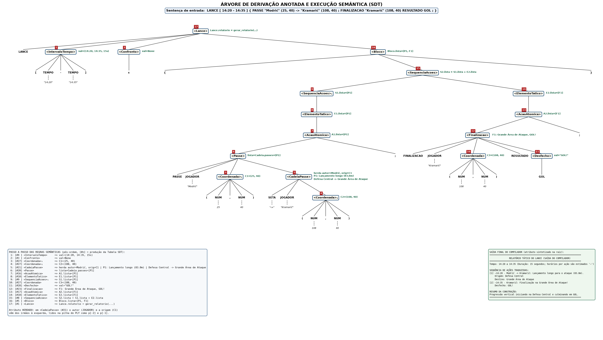
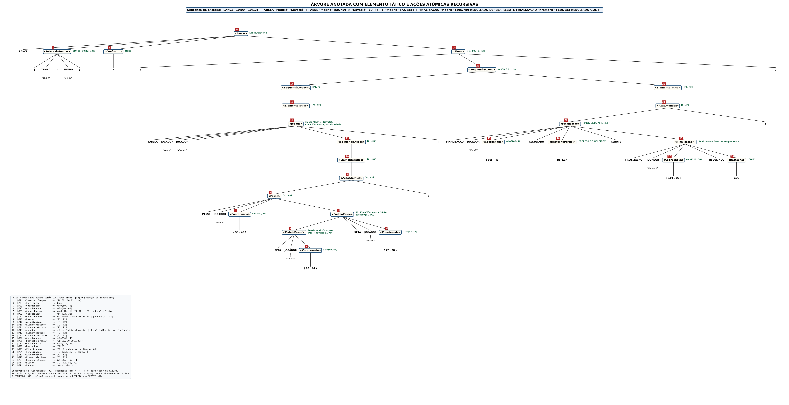

# Exemplo de Árvore de Derivação e Execução Semântica (SDT)

**Disciplina:** Compiladores (2026_2)  
**Projeto:** Tradutor Tático de Lances de Futebol (StatsBomb 120x80)  
**Numeração `[#n]`:** produções da Tabela SDT (`ENTREGA_PRODUCOES_E_REGRAS_SEMANTICAS.md`, 31 produções)

---

## 1. Sentença de entrada analisada

**LANCE [ 14:20 - 14:35 ] { PASSE "Modrić" ( 25 , 40 ) -> "Kramarić" ( 108 , 40 ) ; FINALIZACAO "Kramarić" ( 108 , 40 ) RESULTADO GOL ; }**

---

## 2. Árvore de derivação anotada (caminhamento em profundidade `[1]` → `[17]`)

* **Pós-ordem, esquerda para a direita (*bottom-up*):** desce sempre pelo filho mais à esquerda. Um nó só é numerado depois que todos os seus filhos foram avaliados. É exatamente a ordem em que o `ply.yacc` faz as reduções.
* **Folhas:** cada token mostra seu valor léxico (*lexval*) ligado por linha tracejada.
* **Novidades em relação à versão anterior:** o nó `<Confronto>` derivando **ε** (cabeçalho `"A" VS "B"` opcional) e o nó `<CadeiaPasse>`, que recebe **atributos herdados**.

---

## 3. Passo a passo da execução das regras semânticas

* **1: [#4]** \<IntervaloTempo\> → '[' **TEMPO₁** '-' **TEMPO₂** ']'
  * IntervaloTempo.val = { ini: "14:20", fim: "14:35", duracao: 15 s }
* **2: [#3]** \<Confronto\> → ε
  * Confronto.val = None (sem cabeçalho; as equipes seriam inferidas pelos blocos POSSE)
* **3: [#27]** \<Coordenada\>₁ → '(' **NUM₁** ',' **NUM₂** ')'
  * Verifica 0 ≤ 25 ≤ 120 e 0 ≤ 40 ≤ 80 → **C₁ = (25, 40)**
* **4: [#27]** \<Coordenada\>₂ → '(' **NUM₁** ',' **NUM₂** ')'
  * Verifica 0 ≤ 108 ≤ 120 e 0 ≤ 40 ≤ 80 → **C₂ = (108, 40)**
* **5: [#21]** \<CadeiaPasse\> → **SETA** **JOGADOR** \<Coordenada\>₂
  * **Herda** dos irmãos à esquerda (em #20): autor = "Modrić" (`p[-2]`), origem = C₁ (`p[-1]`)
  * ΔX = 108 − 25 = 83 · ΔY = 0 · d = 83.0 m
  * z_orig = identificar_zona(25, 40) = "Defesa Central"
  * z_dest = identificar_zona(108, 40) = "Grande Área de Ataque"
  * (tipo, dir) = ("Lançamento longo", "para o ataque"). Não é cruzamento: a origem não está no setor de ataque.
  * **CadeiaPasse.passes = [P1]**, CadeiaPasse.ultimo = "Kramarić", CadeiaPasse.ultima_coord = C₂
* **6: [#20]** \<Passe\> → **PASSE** **JOGADOR** \<Coordenada\>₁ \<CadeiaPasse\>
  * Passe.lista = CadeiaPasse.passes = [P1]
* **7: [#16]** \<AcaoAtomica\> → \<Passe\> ';'
  * A₁.lista = [P1]
* **8: [#10]** \<ElementoTatico\> → \<AcaoAtomica\>
  * E₁.lista = [P1]
* **9: [#9]** \<SequenciaAcoes\>₁ → \<ElementoTatico\>
  * **S₁.lista = [P1]** (conclui a subárvore esquerda)
* **10: [#27]** \<Coordenada\> → '(' **NUM₁** ',' **NUM₂** ')'
  * **C₃ = (108, 40)**
* **11: [#28]** \<Desfecho\> → **GOL**
  * Desfecho.val = "GOL!"
* **12: [#23]** \<Finalizacao\> → **FINALIZACAO** **JOGADOR** \<Coordenada\> **RESULTADO** \<Desfecho\>
  * z = identificar_zona(108, 40) = "Grande Área de Ataque"
  * **Finalizacao.lista = [F1]**, com F1 = { Kramarić, Grande Área de Ataque, "GOL!", tentativa 1 }
* **13: [#17]** \<AcaoAtomica\> → \<Finalizacao\> ';'
  * A₂.lista = [F1]
* **14: [#10]** \<ElementoTatico\> → \<AcaoAtomica\>
  * E₂.lista = [F1]
* **15: [#8] (recursão à esquerda)** \<SequenciaAcoes\> → \<SequenciaAcoes\>₁ \<ElementoTatico\>
  * **S₂.lista = S₁.lista + E₂.lista = [P1, F1]**
* **16: [#5]** \<Bloco\> → '{' \<SequenciaAcoes\> '}'
  * Bloco.lista = [P1, F1]
* **17: [#1] (raiz)** \<Lance\> → **LANCE** \<IntervaloTempo\> \<Confronto\> \<Bloco\>
  * **Lance.relatorio = gerar_relatorio(IntervaloTempo.val, Confronto.val, Bloco.lista)**

---

## 4. Exemplo com recursividade

A figura `arvore_recursiva.png` mostra a mesma técnica para uma sentença com **TABELA** (elemento tático recursivo), **passe encadeado** (ação atômica recursiva à esquerda) e **rebote** (ação atômica recursiva à direita). Ver `03_ARVORES_DERIVACAO.md`, Exemplo 3.

