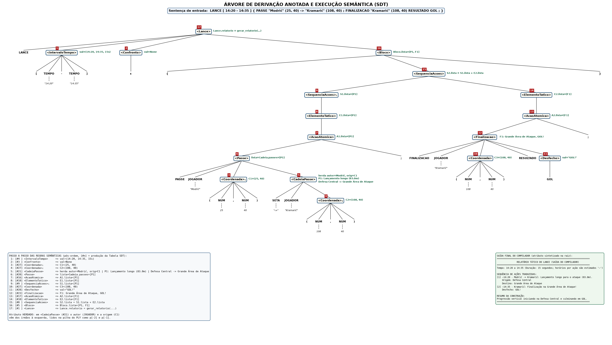

# Manual Intuitivo da Gramática: O Que Chama o Quê, Quando Chama e Como Montar a Árvore

Este documento explica, de forma intuitiva, a gramática do Compilador Tático de Futebol (versão com **31 produções**):
1. A lógica de encaixe: quem pode chamar quem, e quando;
2. As perguntas clássicas da professora, incluindo **recursividade** e **campo por equipe**;
3. A tabela das 31 produções, explicada uma a uma;
4. Como resolver a árvore anotada no estilo do quadro (`[1]` → `[17]`).

---

## PARTE 1: "Quem pode chamar quem e quando?"

Pense na gramática como um **manual de montagem de LEGO**:
* Tudo entre `< >` é uma **caixa (não-terminal)**, que precisa ser aberta e trocada pelas peças do lado direito da seta.
* Tudo em **MAIÚSCULO** ou entre `' '` é uma **peça final (terminal / token)**, ou seja, uma folha da árvore.

```text
[NÍVEL 1: O PROGRAMA]
   <Lance> (#1)  ── LANCE  <IntervaloTempo>  <Confronto>  <Bloco>
      ├── <IntervaloTempo> (#4) ──► '[' TEMPO '-' TEMPO ']'
      └── <Confronto>  (#2) ──► "Croatia" VS "Brazil"     (diz quem é adversário de quem)
                      (#3) ──► ε                        (opcional: pode não existir)

[NÍVEL 2: OS BLOCOS]  <Bloco> tem 3 opções
      ├── #5: '{' <SequenciaAcoes> '}'                    bloco anônimo
      ├── #6: FASE "Nome" '{' <SequenciaAcoes> '}'        rotula a fase tática
      └── #7: POSSE "Time" '{' <SequenciaAcoes> '}'       diz QUAL time executa (e em qual referencial
                                                          estão as coordenadas do bloco)

[NÍVEL 3: A LISTA]  <SequenciaAcoes>
      ├── #9: <ElementoTatico>                            1ª ação (caso base)
      └── #8: <SequenciaAcoes> <ElementoTatico>           2ª, 3ª... ação (recursão à esquerda)

[NÍVEL 4: O QUE PODE SER CADA ITEM]  <ElementoTatico> tem 3 opções
      ├── #10: <AcaoAtomica>                              uma linha terminada em ';'
      ├── #11: <Bloco>                                    um sub-bloco  { ... }       ┐ RECURSIVOS:
      └── #12: <Jogada>                                   uma jogada tática nomeada   ┘ contêm uma lista

[NÍVEL 4b: AS JOGADAS TÁTICAS RECURSIVAS]  <Jogada>  (cada uma VALIDA o próprio conteúdo)
      ├── #13: TABELA "A" "B" '{' ... '}'                 exige A→B e depois B→A
      ├── #14: TRIANGULACAO '{' ... '}'                   exige ≥3 passes entre exatamente 3 jogadores
      └── #15: CONTRA_ATAQUE '{' ... '}'                  exige avanço ≥ 40 m em até 6 passes

[NÍVEL 5: A LINHA]  <AcaoAtomica>
      ├── #16: <Passe> ';'
      ├── #17: <Finalizacao> ';'
      └── #18: <TrocaPosse> ';'  ──► #19: TROCA_POSSE "Time"

[NÍVEL 6: AS AÇÕES ATÔMICAS RECURSIVAS]
   <Passe> (#20) ──► PASSE "A" <Coordenada> <CadeiaPasse>
   <CadeiaPasse>
      ├── #21: -> "B" <Coordenada>                         1º elo (herda "A" e a origem)
      └── #22: <CadeiaPasse> -> "C" <Coordenada>           mais elos: A -> B -> C -> D ...
   <Finalizacao>
      ├── #23: FINALIZACAO "A" <Coordenada> RESULTADO <Desfecho>
      └── #24: FINALIZACAO "A" <Coordenada> RESULTADO <DesfechoParcial> REBOTE <Finalizacao>
   <DesfechoParcial> (#25, #26) ──► DEFESA | TRAVE        (só esses permitem rebote)

[NÍVEL 7: AS FOLHAS COM CÁLCULO]
   <Coordenada> (#27) ──► '(' NUM ',' NUM ')'
   <Desfecho>  (#28–#31) ──► GOL | DEFESA | FORA | TRAVE
```

---

## PARTE 2: Perguntas clássicas da professora

### 1. "Onde está a recursividade da sua linguagem?"
Em **três** lugares, com papéis diferentes:
* **Lista (#8):** `<SequenciaAcoes> → <SequenciaAcoes> <ElementoTatico>`. Recursão à esquerda, só para repetir.
* **Elementos táticos (#11 e #13–#15):** um `<Bloco>` ou `<Jogada>` contém uma `<SequenciaAcoes>`, que pode conter outro `<Bloco>`/`<Jogada>`. Isso é **auto-incorporação** (`{ ... { ... } ... }`), e é o que exige **pilha**. Um `CONTRA_ATAQUE` pode conter uma `TABELA`, e cada nível **valida** o seu conteúdo ao ser reduzido.
* **Ações atômicas (#22 e #24):** o próprio passe é recursivo (`A -> B -> C`, recursão à **esquerda**) e a própria finalização é recursiva (chute → `REBOTE` → chute, recursão à **direita**).

### 2. "Por que o passe encadeado é recursivo à esquerda e o rebote à direita?"
* **Passe encadeado:** a cada novo elo, o parser já pode calcular o passe, porque sabe quem tinha a bola (`ultimo`) e onde (`ultima_coord`). Reduzir cedo é natural, então a recursão é à **esquerda**.
* **Rebote:** o segundo chute é *consequência* do primeiro, então a árvore aninha o rebote dentro do chute anterior (recursão à **direita**). O chute mais interno é reduzido primeiro, e a lista é montada de dentro para fora.
* **Sem conflito LALR(1):** após `DEFESA`, se o próximo token for `;`, é `<Desfecho>` (#29). Se for `REBOTE`, é `<DesfechoParcial>` (#25).

### 3. "O que é o atributo herdado da sua SDT?"
Em `<CadeiaPasse> → SETA JOGADOR <Coordenada>` (#21), o **autor** e a **origem** do primeiro passe não estão nesta produção. Eles estão nos irmãos à esquerda, na produção #20 (`PASSE JOGADOR <Coordenada> <CadeiaPasse>`). Como o parser LR já empilhou esses irmãos, a ação os lê com `p[-2]` e `p[-1]`, o equivalente ao `$0` do Bison. Um atributo que vem do pai ou dos irmãos à esquerda é **herdado**, por isso a definição é **L-atribuída**.

### 4. "O campo de ataque do Brasil é o mesmo da Croácia?"
**Não.** Cada coordenada está no referencial **do time que executa a ação**, como na StatsBomb: X = 120 é sempre o gol adversário de quem age. O mesmo ponto visto pelo adversário é **(120 − x, 80 − y)**. Por isso:
* o `Ataque Esquerdo` da Croácia é a `Defesa Direita` do Brasil;
* o relatório mostra as duas perspectivas, por exemplo `Ataque Direito (Croatia) = Defesa Esquerda (Brazil)`;
* na troca de posse, ele mostra onde a bola foi recuperada **para os dois times**;
* o cabeçalho `"Croatia" VS "Brazil"` informa o adversário, e o compilador rejeita `POSSE "Argentina"` nesse lance (erro semântico).

### 5. "Por que existem `<ElementoTatico>` e `<AcaoAtomica>` separados?"
`<AcaoAtomica>` é **uma linha** que termina em `;`. `<ElementoTatico>` é **qualquer item** da lista: uma linha, um sub-bloco `{ }` ou uma jogada nomeada. Blocos e jogadas não têm `;` depois do `}`. É o `<ElementoTatico>` que permite misturar livremente linhas, sub-blocos e jogadas.

---

## PARTE 3: As 31 produções, uma a uma

| # | Produção | Quando é usada | O que calcula |
| :-: | :--- | :--- | :--- |
| 1 | \<Lance\> → LANCE \<IntervaloTempo\> \<Confronto\> \<Bloco\> | sempre, na raiz | valida equipes × confronto; gera o relatório |
| 2 | \<Confronto\> → JOGADOR VS JOGADOR | quando há `"A" VS "B"` | par de equipes (A ≠ B) |
| 3 | \<Confronto\> → ε | quando não há cabeçalho | None |
| 4 | \<IntervaloTempo\> → '[' TEMPO '-' TEMPO ']' | após LANCE | início, fim, duração (segundos 00..59; fim ≥ início) |
| 5 | \<Bloco\> → '{' Seq '}' | bloco anônimo | repassa a lista |
| 6 | \<Bloco\> → FASE JOGADOR '{' Seq '}' | `FASE "Nome" {` | rotula a fase ("Externa > Interna") |
| 7 | \<Bloco\> → POSSE JOGADOR '{' Seq '}' | `POSSE "Time" {` | define a equipe (e o referencial) das ações |
| 8 | Seq → Seq ElementoTatico | 2ª ação em diante | concatena listas |
| 9 | Seq → ElementoTatico | 1ª ação | inicia a lista |
| 10 | ElementoTatico → AcaoAtomica | linha com `;` | repassa a lista |
| 11 | ElementoTatico → Bloco | sub-bloco | auto-incorporação |
| 12 | ElementoTatico → Jogada | jogada nomeada | repassa a lista validada |
| 13 | Jogada → TABELA JOGADOR JOGADOR '{' Seq '}' | `TABELA "A" "B" {` | valida A ≠ B, A→B, B→A, uma só equipe; rotula |
| 14 | Jogada → TRIANGULACAO '{' Seq '}' | `TRIANGULACAO {` | valida 3 jogadores, ≥ 3 passes, uma só equipe |
| 15 | Jogada → CONTRA_ATAQUE '{' Seq '}' | `CONTRA_ATAQUE {` | valida avanço ≥ 40 m em ≤ 6 passes, uma só equipe |
| 16 | AcaoAtomica → Passe ';' | linha PASSE | lista de passes |
| 17 | AcaoAtomica → Finalizacao ';' | linha FINALIZACAO | lista de chutes |
| 18 | AcaoAtomica → TrocaPosse ';' | linha TROCA_POSSE | [troca] |
| 19 | TrocaPosse → TROCA_POSSE JOGADOR | `TROCA_POSSE "Time"` | nova equipe com a posse (a próxima ação tem de ser dela) |
| 20 | Passe → PASSE JOGADOR Coordenada CadeiaPasse | `PASSE "A" (x,y) -> ...` | lista de passes da cadeia |
| 21 | CadeiaPasse → SETA JOGADOR Coordenada | 1º elo | **herda** autor/origem; calcula P1 |
| 22 | CadeiaPasse → CadeiaPasse SETA JOGADOR Coordenada | elos seguintes | passe a partir do último receptor |
| 23 | Finalizacao → FINALIZACAO JOGADOR Coordenada RESULTADO Desfecho | chute final | zona + desfecho |
| 24 | Finalizacao → … RESULTADO DesfechoParcial REBOTE Finalizacao | chute com rebote | [chute] + rebotes numerados |
| 25–26 | DesfechoParcial → DEFESA \| TRAVE | antes de REBOTE | texto do desfecho |
| 27 | Coordenada → '(' NUM ',' NUM ')' | todo `(x, y)` | valida 0..120 × 0..80 |
| 28–31 | Desfecho → GOL \| DEFESA \| FORA \| TRAVE | após RESULTADO | texto do desfecho |

**Cálculos de um passe** (#21/#22): ΔX, ΔY, d = √(ΔX² + ΔY²), zona de origem e destino (11 zonas), tipo (curto ≤ 15 m, médio ≤ 30 m, lançamento > 30 m; cruzamento quando a origem está no ataque, num corredor lateral, e o destino é a grande área) e direção.

---

## PARTE 4: Árvore no estilo do quadro

Sentença: **LANCE [ 14:20 - 14:35 ] { PASSE "Modrić" ( 25 , 40 ) -> "Kramarić" ( 108 , 40 ) ; FINALIZACAO "Kramarić" ( 108 , 40 ) RESULTADO GOL ; }**



### Como numerar `[1]` até `[17]`
> **Regra de ouro:** desça sempre pelo filho mais à esquerda. Só numere um nó quando **todos** os filhos dele já estiverem prontos.

1. **Tempo:** `<IntervaloTempo>` só tem folhas, então recebe **[1]** (#4).
2. **Confronto:** `<Confronto>` deriva ε, então recebe **[2]** (#3).
3. **Passe:** desça por `<Bloco>` → `<SequenciaAcoes>` → `<SequenciaAcoes>₁` → `<ElementoTatico>` → `<AcaoAtomica>` → `<Passe>`.
   * `PASSE` e `"Modrić"` são folhas. `<Coordenada>₁` recebe **[3]** (C1 = (25, 40)).
   * Entre em `<CadeiaPasse>`: `SETA` e `"Kramarić"` são folhas. `<Coordenada>₂` recebe **[4]** (C2 = (108, 40)).
   * `<CadeiaPasse>` recebe **[5]** (#21). Ele **herda** Modrić e C1 e calcula P1: 83 m, lançamento longo para o ataque, Defesa Central → Grande Área de Ataque.
   * Subindo: `<Passe>` **[6]** → `<AcaoAtomica>` **[7]** → `<ElementoTatico>` **[8]** → `<SequenciaAcoes>₁` **[9]**.
4. **Finalização:** desça pelo ramo direito. `<Coordenada>` recebe **[10]** e `<Desfecho>` recebe **[11]**. Depois `<Finalizacao>` **[12]** → `<AcaoAtomica>` **[13]** → `<ElementoTatico>` **[14]**.
5. **Encontro:** `<SequenciaAcoes>` **[15]** (#8) faz [P1] + [F1]. Depois `<Bloco>` **[16]** e, na raiz, `<Lance>` **[17]**, que imprime o relatório.

Para a versão com recursividade (TABELA + passe encadeado + rebote), veja `arvore_recursiva.png` e `03_ARVORES_DERIVACAO.md`.
